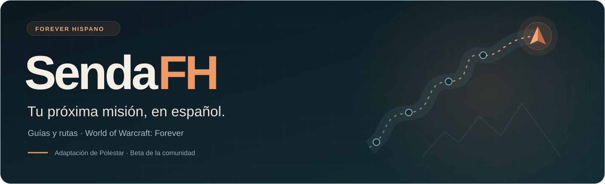
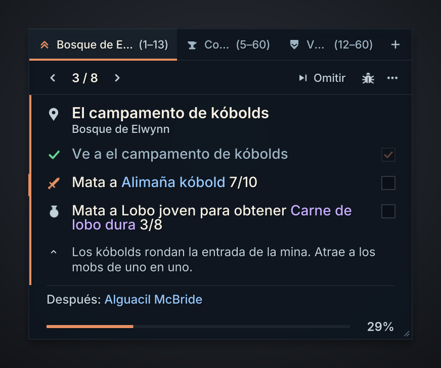
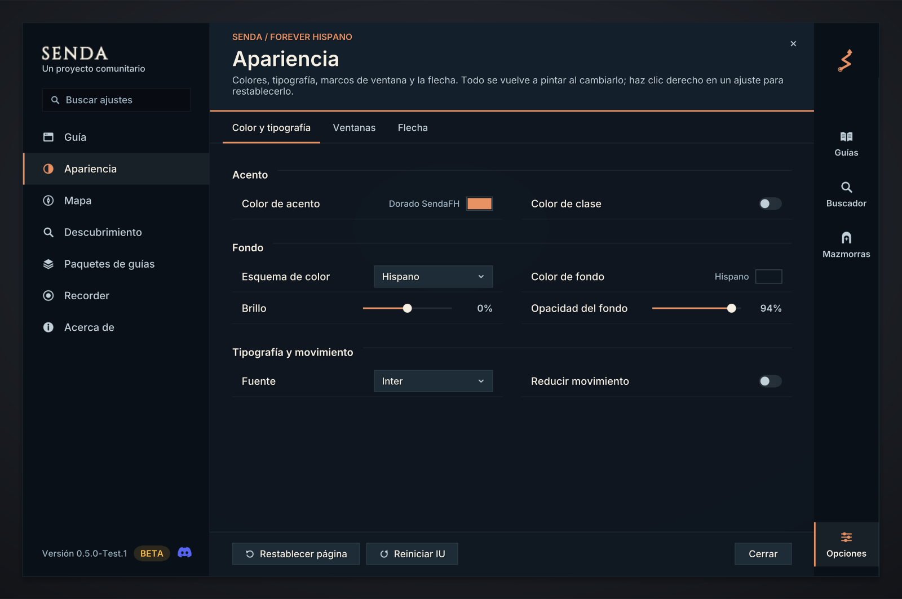

<p align="center">
  
</p>

<p align="center">
  <strong>Guías de leveo para World of Warcraft: Forever, adaptadas para Forever Hispano.</strong><br>
  Misiones, rutas y objetivos en español, dentro del juego.
</p>

<p align="center">
  <a href="https://discord.gg/qkW5Y8yzk6">Discord de Forever Hispano</a> ·
  <a href="https://github.com/julen92/SendaFH/issues/new/choose">Reportar un fallo</a> ·
  <a href="https://github.com/julen92/SendaFH/releases">Versiones</a> ·
  <a href="https://github.com/fitzforge/polestar">Polestar original</a>
</p>

## Qué es SendaFH

**SendaFH es una adaptación de [Polestar](https://github.com/fitzforge/polestar), de Fitz y sus colaboradores**, mantenida por Forever Hispano. Partimos de su trabajo y añadimos nuestra traducción, estilo visual y soporte para la comunidad hispana.

La idea es que puedas centrarte en jugar: qué misión aceptar, qué mobs necesitas, dónde entregar y cómo llegar al siguiente objetivo.

| Durante el leveo | Lo que encontrarás |
| --- | --- |
| **Misiones paso a paso** | Objetivos y progreso en la ventana de la guía. |
| **220 guías en la beta preparada** | Leveo, clases, profesiones, monturas y más contenido de la base de Polestar. |
| **Flecha y rutas** | Caminos a pie y viajes con vuelos, barcos, zepelines, portales y piedra de hogar. |
| **Clases y mazmorras** | Cadenas de clase, avisos de grupo, misiones de mazmorra y requisitos de acceso. |
| **Equipo y progreso** | Consejos de equipo, planes de talentos disponibles y seguimiento de XP. |
| **Español y comunidad** | Interfaz esES y esMX, traducción de guías y nombres localizados cuando existen en los datos del juego. |

Las funciones de la base son trabajo de Polestar y de los proyectos que integra. Nuestra aportación se centra en la adaptación para Forever Hispano. Consulta los [créditos](docs/sendafh/CREDITOS.md).

## Estado y descarga

**Beta preparada: `0.5.0-test.1`, basada en Polestar `v0.2.5-test.1`.**

Todavía no hay un instalable de SendaFH publicado en las Releases de este repositorio. Si quieres probar la beta que estamos preparando, entra en el [Discord de Forever Hispano](https://discord.gg/qkW5Y8yzk6) y pide el paquete de pruebas.

Cuando publiquemos un instalable, estará en **[Releases](https://github.com/julen92/SendaFH/releases)**, identificado como beta y acompañado de su código fuente. **Code → Download ZIP descarga las fuentes de esta rama; no es el paquete instalable de SendaFH.** Esta rama contiene la portada y el soporte sobre el código heredado de Polestar; la publicación del código completo de la adaptación está pendiente.

No tenemos una publicación de SendaFH en CurseForge anunciada todavía. Los enlaces de descarga se añadirán aquí cuando esté disponible.

Parte de la traducción está asistida por IA y necesita revisión jugando. Algunos nombres exclusivos de Forever pueden seguir en inglés. Las rutas también están en beta: si una flecha te manda por un sitio imposible, [repórtalo](https://github.com/julen92/SendaFH/issues/new?template=wrong-step.yml).

## Así se ve

<p align="center">
  
</p>

<p align="center">
  
</p>

*Vistas previas generadas con la interfaz Lua de la beta y datos de ejemplo, fuera del juego. No son capturas de una sesión real.*

## Instalación de la beta

Cuando tengas el **ZIP instalable de SendaFH**:

1. **Cierra WoW por completo.**
2. Guarda una copia de tus carpetas anteriores fuera de `Interface/AddOns`.
3. Descomprime las ocho carpetas del paquete directamente en `Interface/AddOns`, sin una carpeta extra entre medias.
4. Conserva `WTF`: ahí están tus ajustes y el progreso guardado.
5. Abre el juego y revisa que los módulos de SendaFH estén activados en la lista de addons.

<details>
<summary>Las ocho carpetas que debe incluir el instalable</summary>

```text
Interface/AddOns/
├── SendaFH/
├── SendaFH_Guides/
├── SendaFH_ItemDB/
├── SendaFH_QuestDB/
├── SendaFH_Codex/
├── SendaFH_Nav/
├── SendaFH_Names_esES/
└── SendaFH_Names_esMX/
```

Se carga el paquete de nombres que corresponda al idioma de tu cliente.

</details>

**Si vienes de SendaFH 0.4.0:** sustituye las carpetas por las nuevas y conserva `WTF`; no necesitas repetir la migración. Un `/reload` no basta para cargar los módulos nuevos.

**Si vienes de Polestar:** consulta primero el [Discord](https://discord.gg/qkW5Y8yzk6) y las instrucciones del paquete. El instalable incluye `SendaFH/Migrar-SendaFH.cmd` para migrar los datos con el juego cerrado. Conserva una copia de seguridad y evita tener ambos addons activos a la vez.

## Primeros pasos

- Escribe **`/senda`** para mostrar la guía.
- Usa **`/senda guides`** para elegir otra guía y **`/senda options`** para abrir los ajustes.
- Si encuentras un problema, pulsa el botón de fallo de la guía o usa **`/senda report`** para copiar el informe.

## Ayúdanos a mejorarlo

| Has encontrado… | Dónde contarlo |
| --- | --- |
| Un error Lua o algo que no funciona | [Reportar un fallo](https://github.com/julen92/SendaFH/issues/new?template=bug-report.yml) |
| Un NPC mal situado, un objetivo que no cuenta o una ruta imposible | [Reportar un paso o una ruta](https://github.com/julen92/SendaFH/issues/new?template=wrong-step.yml) |
| Una frase en inglés, un nombre raro o una traducción que chirría | [Mejorar una traducción](https://github.com/julen92/SendaFH/issues/new?template=translation.yml) |
| Una idea para el addon | [Proponer una mejora](https://github.com/julen92/SendaFH/issues/new?template=feature-request.yml) |
| Una duda de instalación o de uso | [Discord de Forever Hispano](https://discord.gg/qkW5Y8yzk6) |

Incluye la versión de SendaFH, la guía y el paso, qué esperabas y qué ha ocurrido. Una captura y el informe del addon nos ayudan a encontrar el problema. Más detalles en [cómo reportar fallos](docs/sendafh/SOPORTE.md).

**Estos reportes son de SendaFH.** Si una mejora también sirve para Polestar, la proponemos al proyecto original. Ya hemos enviado [122 mejoras de traducción en el PR #139](https://github.com/fitzforge/polestar/pull/139).

## Créditos y licencia

- **Polestar:** [Fitz / fitzforge y colaboradores](https://github.com/fitzforge/polestar), autores del proyecto original.
- **SendaFH:** adaptación, traducción y soporte de **Forever Hispano**.
- **Shortest Path Forever:** [Cillian Berragan / cjber](https://github.com/cjber/shortest-path-forever), cuyo motor de navegación integra Polestar.
- **Datos y nombres:** se conservan los créditos a Ding!, Yendi, pfQuest, Questie, QuestieDB, Carbonite y las demás fuentes utilizadas.

SendaFH es una adaptación de la comunidad; no es una versión oficial publicada por el equipo de Polestar. Conservamos las licencias y atribuciones originales, incluidas las específicas de datos, navegación y fuentes. Consulta [LICENSE](LICENSE), [LICENSE-EXCEPTION.md](LICENSE-EXCEPTION.md) y los [créditos ampliados](docs/sendafh/CREDITOS.md).

El [README original de Polestar](https://github.com/fitzforge/polestar/blob/1bf65e146007bddd9f2c63a66c29781a5e94b1bc/README.md) y su historial siguen disponibles como referencia.

---

<p align="center"><strong>Forever Hispano · Nos vemos en Azeroth.</strong></p>
